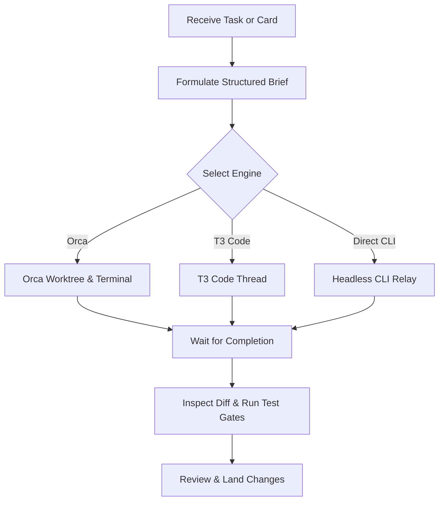

# Delegate

Delegate implementation cards and tasks to standalone AI agent CLIs—leveraging **Orca CLI sessions**, **T3 Code threads**, or falling back to **direct headless CLI relays**.

Delegation follows the **Review-First Philosophy**:
1. Formulate a self-contained, unambiguous brief.
2. The implementer CLI executes in an isolated session or worktree.
3. The orchestrator inspects the resulting diff and runs verification commands.
4. Review and land changes—**never blind auto-commits**.

---

## 1. Trigger & Modes

Trigger delegation from chat or playbooks:

```text
/delegate codex: implement table view pagination
/delegate claude --model claude-3-7-sonnet --reasoning high: refactor authentication
/delegate fix the race condition in cache eviction
```

### Supported Execution Engines
- **Orca CLI Session**: Runs in an isolated Git worktree with interactive PTY terminal and idle-state detection. See the [Orca Session Reference](references/orca-session.md).
- **T3 Code Thread**: Runs via `t3 thread start` with worktree isolation and structured JSON output. See the [T3 Code Session Reference](references/t3-session.md).
- **Direct CLI Relay**: Headless non-interactive execution (`codex exec`, `claude -p`, `omp`, `pi -p`). See the [Direct CLI Reference](references/direct-cli.md).

Outputs adhere to the [Schema Specification](references/schemas.md).

---

## 2. Delegation Workflow



### Step 1: Formulate the Task Brief
Because delegated agents run in a separate session without active chat history, the brief must be self-contained. See [Brief Templates](examples/brief-templates.md) for standard formats:
- Objective and scope of target files
- Hard constraint: NO COMMITS (leave changes in working tree)
- Verification test command

### Step 2: Dispatch Delegation
Use the companion helper script:
```bash
python3 src/skills/delegate/scripts/delegate.py \
  --agent codex \
  --brief "brief.md" \
  --verify "make verify" \
  --json
```

Discover installed coding agents on the current host:
```bash
python3 src/skills/delegate/scripts/discover_agents.py
```

### Step 3: Inspect Diff & Verification
Check touched files and verification test output:
```bash
git status --short
git diff --stat
make verify
```

Hand back results for review before landing.
