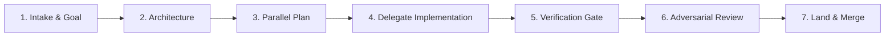

# Playbook: Delivery

The delivery playbook takes an engineering goal from raw request to fully tested, reviewed, and landed code across one or more repositories.

## Workflow Phases



### Phase 1: Intake & Acceptance Predicate
1. Formulate the goal in one observable sentence.
2. Define the exact acceptance command that proves completion (e.g., `make verify`, `pytest`, `npm test`).
3. If no verification command exists, establish one first using `verify-create`.

### Phase 2: Architecture & Contracts
1. Read project architecture (`ARCHITECTURE.md`) and repository maps.
2. For changes crossing package or functional boundaries, sketch design alternatives using `architect`.
3. Settle public interfaces and schemas before writing implementations.

### Phase 3: Card Planning
1. Use `planner` to decompose the goal into independent cards with disjoint file scopes.
2. Define clear boundaries, acceptance criteria, and risk level (`low`, `standard`, `money-path`) per card.

### Phase 4: Delegated Implementation
1. For each card, generate a structured brief from the templates in `delegate`.
2. Dispatch implementation via Orca CLI session, T3 Code thread, or direct CLI relay using the `delegate` skill:
   ```bash
   python3 src/skills/delegate/scripts/delegate.py \
     --agent codex \
     --brief "brief.md" \
     --verify "make verify" \
     --json
   ```
3. For solo execution without delegation, switch to `playbook-solo`.

### Phase 5: Verification & Testing
1. Run static checks, formatting, and unit tests on the resulting diff.
2. For money-path changes, execute replay tests (`replay-test`) or formal checks (`formal-verify`).
3. Clean unnecessary comments or temporary debug code using `deslop`.

### Phase 6: Adversarial Review
1. Review the diff with a separate model or reviewer agent using `reviewer` and `interrogate`.
2. Keep only findings proven by a concrete failing command or execution trace.

### Phase 7: Landing & Documentation
1. Sync documentation using `docs-sync`.
2. Update changelog entries using `changelog`.
3. Open PR and land through the merge gate using `github` and `playbook-land`.
